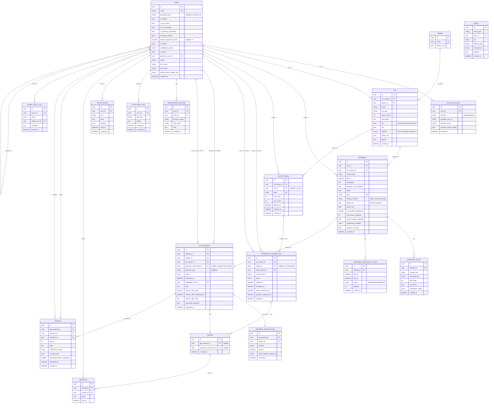

# StageConnect data model

Trust-first gig marketplace schema (PostgreSQL). The diagram below matches the SQLAlchemy models in `backend/app/models/`.

## Location privacy (core domain rule)

| Surface | Act (`acts`) | Offering (`offerings`) |
|---------|--------------|------------------------|
| Public pages / maps | Hidden | `display_location` + jittered `public_lat/lng` only |
| Authenticated verified bookers | Still hidden until gig approved | Venue area only until confirmed |
| Confirmed gig parties | Exact act service-area address may appear in post-approval flows | Full venue details per product policy |

Act home base / rehearsal location is **private** (service area). Event **venue** is **public at approximate precision** on listing pages — distinct from the equine marketplace pattern where animal address was fully fuzzed.

## Related documents

- [Data model additions](specs/data-model-additions.md)
- [Gig lifecycle spec](specs/gig-lifecycle-spec.md)
- [Public acts & invite links](specs/public-acts-and-invite-links-spec.md)
- [Anti-abuse](safety/anti-abuse.md)
