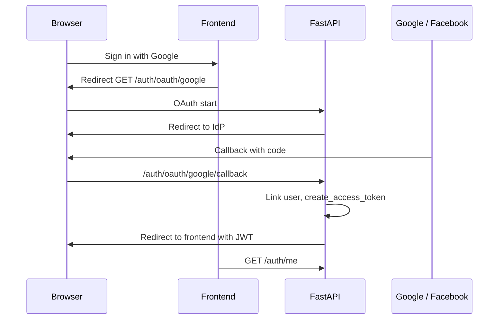

# OAuth SSO Design (Google & Facebook)

Architecture for StageConnect social login. Backend-owned flow; OAuth is **authentication only**, not KYC.

## Goals

- Sign in or register with Google or Facebook alongside email/password.
- Centralize token issuance in FastAPI with existing JWT + verification gating.
- Same session model as `POST /auth/login`.

## Decision: backend-owned OAuth

Frontend redirects to FastAPI OAuth routes; backend exchanges code, links `OAuthAccount`, issues JWT, redirects to frontend callback URL.

Rejected: NextAuth-only (splits auth and verification rules).

## Authlib

Use **Authlib** for Google (OIDC) and Facebook OAuth2 client flows when implemented.

Env vars (see `.env.example`): `GOOGLE_CLIENT_ID`, `GOOGLE_CLIENT_SECRET`, `GOOGLE_REDIRECT_URI`, Facebook equivalents, `FRONTEND_OAUTH_SUCCESS_URL`, `FRONTEND_OAUTH_ERROR_URL`.

## Account linking

1. Primary key remains `users.id`.
2. Link by **verified provider email** to existing `users.email`.
3. Store `(provider, provider_user_id)` on `oauth_accounts` — one row per provider identity.
4. Linking does not upgrade `verification_status`.
5. Reject unverified provider emails.
6. Minors: OAuth does not bypass guardian rules.

## Fit with existing auth

| Piece | Behavior |
|-------|----------|
| Password login | Unchanged |
| JWT | HS256, `sub` = user UUID |
| Frontend storage | Bearer token (see `frontend/lib/auth.ts`) |
| Protected routes | `get_current_user` |

Relevant code: `backend/app/routers/auth.py`, `backend/app/models/oauth_account.py`, `backend/app/services/security.py`.

## MVP note

OAuth routes may be stubbed; email/password remains primary for dev seeds. UI buttons can be deferred; design stands for implementation tasks.
