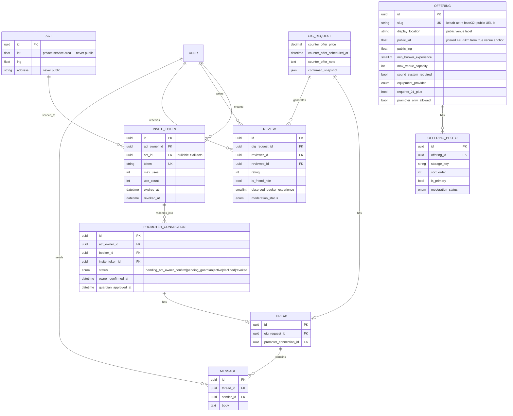

# Data model additions — public offerings, invites, threads, reviews

Companion to [data-model.md](../data-model.md). Documents entities and constraints beyond the base sketch; aligns with Alembic migrations in `backend/alembic/versions/`.

## Migration & constraint notes

### THREAD (replaces MESSAGE → GIG FK)

- Check constraint: exactly one parent — `(gig_request_id IS NULL) <> (promoter_connection_id IS NULL)`.
- Partial unique indexes: one thread per gig / per promoter connection.
- Promoter thread opens only when `PROMOTER_CONNECTION.status = active`.

### INVITE_TOKEN

- Generate with `secrets.token_urlsafe(24)`; do not log plaintext tokens.
- Atomic redemption: increment `use_count` only when under `max_uses`, not revoked, not expired.
- Rate limits: ≤10 active tokens per owner; ≤25 redemptions per owner per 30 days → admin queue.

### Public location split (StageConnect-specific)

- **Offering** public fields describe **where the gig happens** (venue area).
- **Act** coordinates describe **private service area** (home base / travel origin) and must never serialize on `/api/public/*`.
- `LOCATION_JITTER_SECRET` (or `service_area_default_secret` in config) supports deterministic jitter per entity id.

### REVIEW

- Unique `(gig_request_id, reviewer_id)`.
- Completed gigs only; promoter/free gigs flagged `is_friend_ride` on display.
- `observed_booker_experience` — owner observation of booker skill (optional).

### GIG counter-offer & snapshot

- Counter-offer columns nullable until used.
- `confirmed_snapshot` written once at approval; treat as immutable terms record for disputes.

### Platform flags

- `minor_connection_skew`, `invite_redemption_rate`, `artist_fee_request`, `deposit_scam_pattern`, `off_platform_contact`.

### Manager roles

- `is_act_manager`, `is_booking_coordinator`, `manager_verified` — delegated access; host capability remains on verified act owners.

## Related documents

- [Gig lifecycle spec](gig-lifecycle-spec.md)
- [Public acts & invite links](public-acts-and-invite-links-spec.md)
- [Anti-abuse](../safety/anti-abuse.md)
